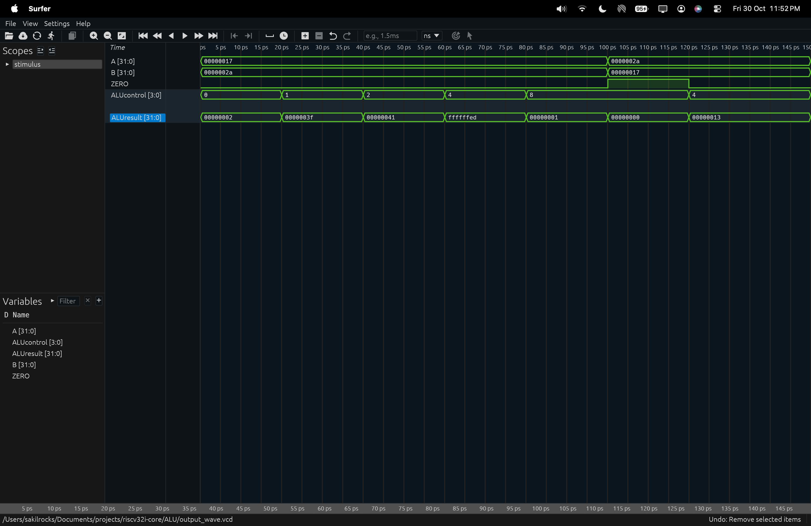
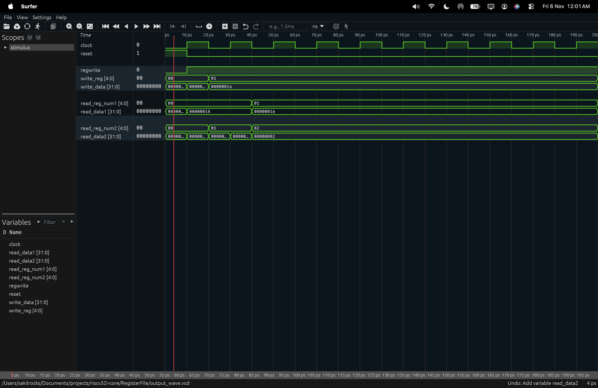
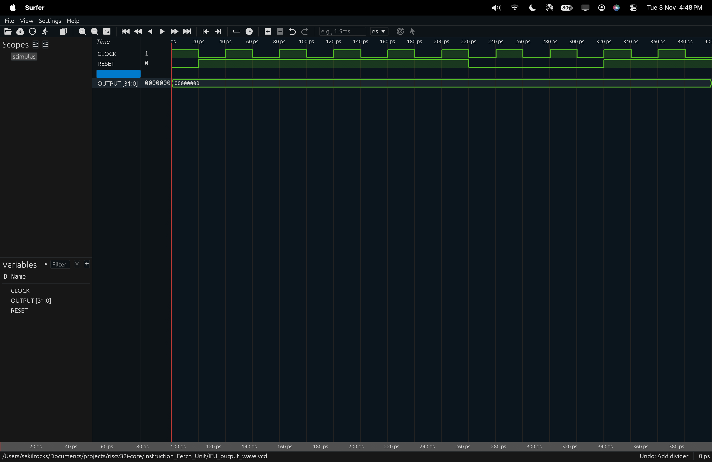
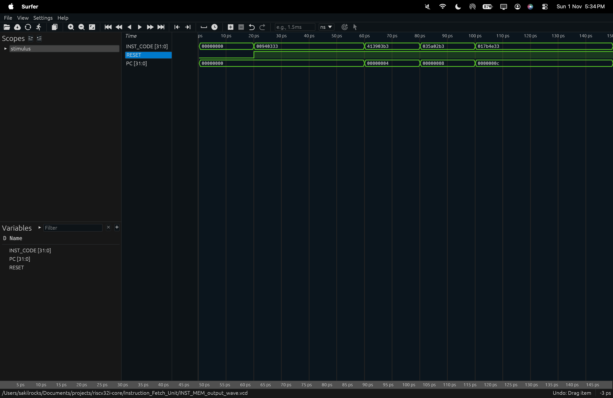
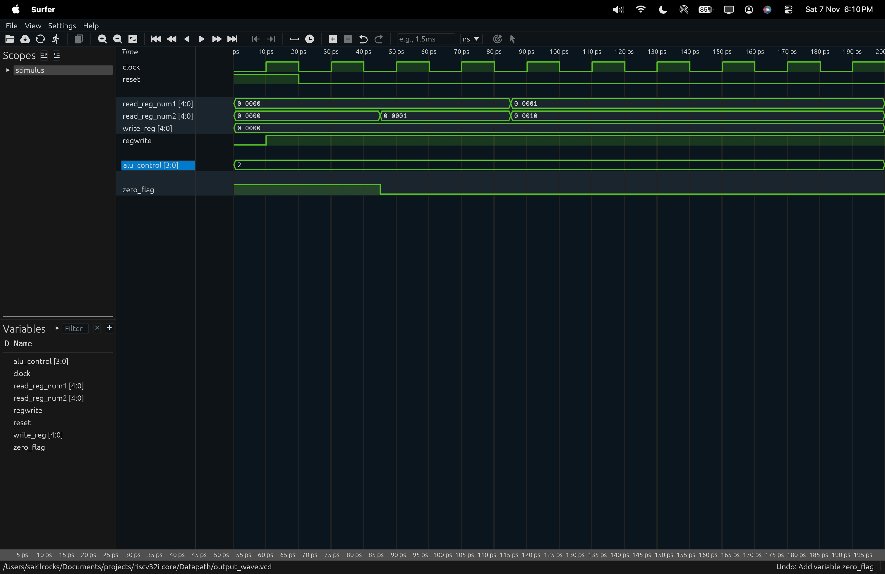

# riscv-processor

a multi stage, 32-bit RISC-V processor implementing the RV32I base integer instruction set, designed and written in SystemVerilog.

This project is an exploration of processor architecture and digital design, focusing on how individual hardware components work together to
execute instructions.

---

## Overview

The processor is built using modular hardware components, with each module responsible for a specific part of the instruction execution process.

The design is divided into the following major components:
* Instruction Fetch Unit (IFU): Fetches instructions from instruction memory and maintains the program counter.
* Control Unit: Decodes instructions and generates the control signals required for execution.
* Register File: Stores the processor's general-purpose registers and handles register reads and writes.
* Arithmetic Logic Unit (ALU): Performs arithmetic and logical operations.
* Datapath: Connects the functional units and provides the data paths required for instruction execution.
* Processor: Integrates the individual modules into a complete processor.

---

## Implementation

| Category | Technology |
|------|------|
|Architecture | RISC-V |
| Instruction Set |RV32I |
| Data Width | 32-bit |
|Hardware Description Language | SystemVerilog |
| Simulation | Verilator |
| Waveform Viewer | Surfer |

---

## Project Structure

```
riscv32i-core/
  ├── ALU/
  ├── Control Unit/
  ├── Datapath/
  ├── Instruction Fetch Unit/
  ├── Processor/
  ├── Register File/
  ├── docs/
  ├── .gitattributes
  ├── .gitignore
  ├── LICENSE
  └── README.md
```

---

## Components and Files

### 1. ALU

* Responsible for performing arithmetic and logical operations required by the processor.
* Operations are selected using the ALU control signals generated by the Control Unit.

### 2. Control Unit

* Decodes the fetched instruction and determines which operations the processor needs to perform.
* It generates control signals that coordinate the ALU, register file, and datapath.

### 3. Datapath

* Contains the data-processing and data-routing logic.
* It connects the register file, ALU, and other functional units, allowing instructions to move data through the processor.

### 4. Instruction Fetch Unit

* Responsible for retrieving instructions from instruction memory.
* It maintains the Program Counter (PC), which identifies the address of the next instruction to be fetched.

### 5. Register File

* Implements the processor's general-purpose register storage.
* It provides the registers required by instructions and handles write-back of results.

### 6. Processor

* The top-level module that integrates the individual hardware components.
* It connects the IFU, Control Unit, Datapath, and other modules to form the complete processor.

---

## How It Works

*The processor executes instructions through a sequence of coordinated hardware operations.*

The overall instruction execution flow can be understood as follows:

* Instruction Fetch: The IFU uses the Program Counter to retrieve an instruction from instruction memory.
* Instruction Decode: The Control Unit interprets the instruction and generates the necessary control signals.
* Register Read: The required source operands are read from the Register File.
* Execution: The ALU performs the required arithmetic or logical operation using the selected operands.
* Write Back: The resulting data is written back into the destination register when required.
* Next Instruction: The Program Counter is updated to determine the next instruction address.

These operations are coordinated by the Processor module through the interconnected datapath and control signals.

---

## Simulation Waveforms

* ALU: Arithmetic and logical operations.




* Register File: Register reads and writes.




* IFU: Program counter and instruction fetching.




* Instruction Memory: Instruction storage and retrieval




* Datapath: Data movement between processor components


